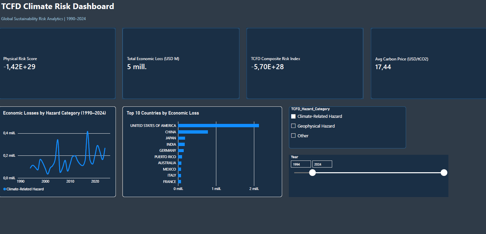

# 03 · Sustainability Risk Analytics — TCFD Climate Risk Dashboard

## Overview
A professional **TCFD-aligned climate risk dashboard** built in Power BI, analysing physical and transition climate risks across 180+ countries using real-world open datasets (1990–2024).

## Business Context
Financial institutions and corporations are increasingly required to disclose climate-related risks under the **Task Force on Climate-related Financial Disclosures (TCFD)** framework. This dashboard provides the analytical foundation for such disclosures, quantifying both physical risks (extreme weather events) and transition risks (carbon pricing gap).

## Dashboard Pages
| Page | Description |
|---|---|
| Executive Risk Summary | Global KPIs, economic loss trends, top-10 country exposure |
| Physical Risk Deep Dive | ND-GAIN vulnerability & readiness analysis by country |
| Transition Risk & Carbon Pricing | Paris Agreement alignment gap, carbon price coverage |
| TCFD Scenario Analysis | IPCC AR6 warming scenarios (1.5°C / 2°C / 3°C) projections |

## Data Sources
| Dataset | Source | Coverage |
|---|---|---|
| EM-DAT International Disasters | CRED / UCLouvain | 1990–2024 |
| ND-GAIN Country Index | University of Notre Dame | 1995–2024 |
| World Bank GDP | World Bank Open Data | 1990–2024 |
| Carbon Pricing Dashboard | World Bank | 1990–2026 |

## Key Metrics
- **Physical Risk Score** = Vulnerability × (1 − Readiness) — ND-GAIN methodology
- **TCFD Composite Risk Index** = Physical 40% + Transition 30% + Economic Loss 20% + Coverage Gap 10%
- **Scenario Multipliers** (IPCC AR6): 1.35× (1.5°C) · 1.85× (2°C) · 2.90× (3°C)
- **Paris Target Gap** = $100/tCO2 − Current Avg Carbon Price (Stern-Stiglitz Commission)

## Tools & Skills
`Power BI Desktop` `Power Query` `DAX` `Star Schema` `TCFD Framework` `ESG Analytics` `ND-GAIN Index` `EM-DAT` `World Bank API`

## File Structure
